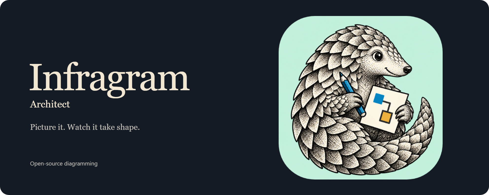

# Infragram Architect

**Picture it. Watch it take shape.**

**Ask your coding agent for an architecture diagram.** It writes the diagram as
code, checks the drawing, and gives you an editor that opens offline. Browse
components, edit labels, drag nodes, switch between cards and icons, and export
HTML, SVG, PNG, draw.io or a Terraform skeleton. Draw clouds, Kubernetes and
datacenters; write the Python yourself, or import what already exists.

| AWS: three-tier web app | AWS: GitHub Actions pipeline, numbered steps |
|---|---|
| [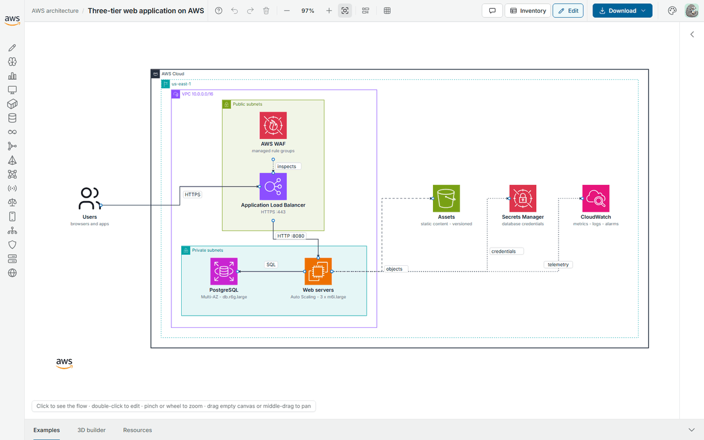](docs/media/infragram-tour.mp4) | [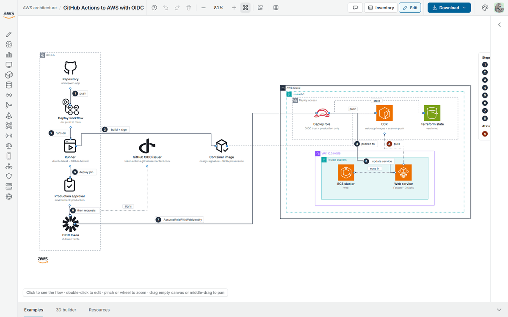](docs/media/infragram-tour.mp4) |
| **Azure: AKS baseline, dark theme** | **Google Cloud: streaming analytics** |
| [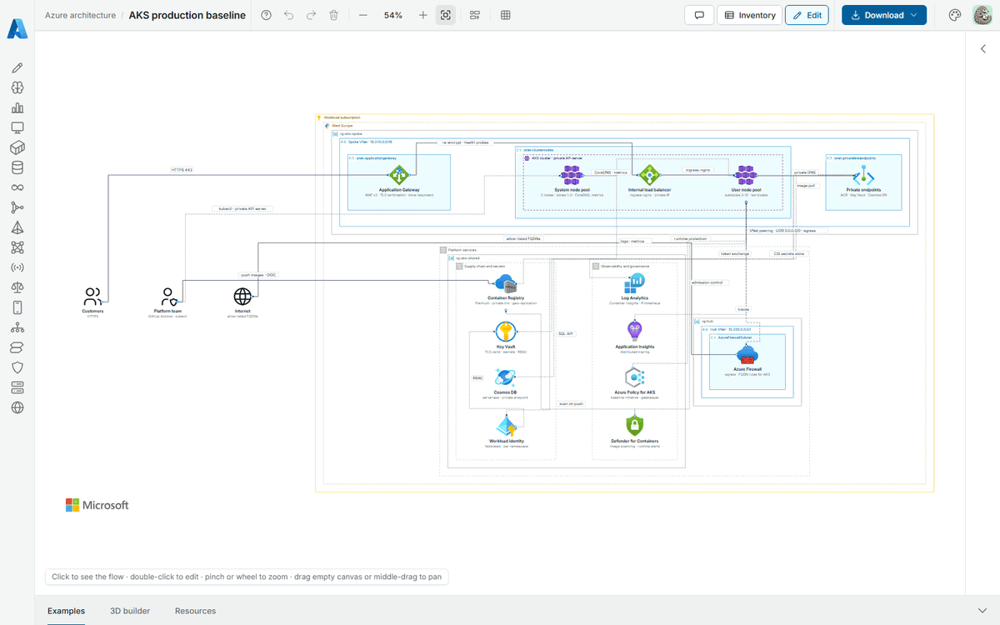](docs/media/infragram-tour.mp4) | [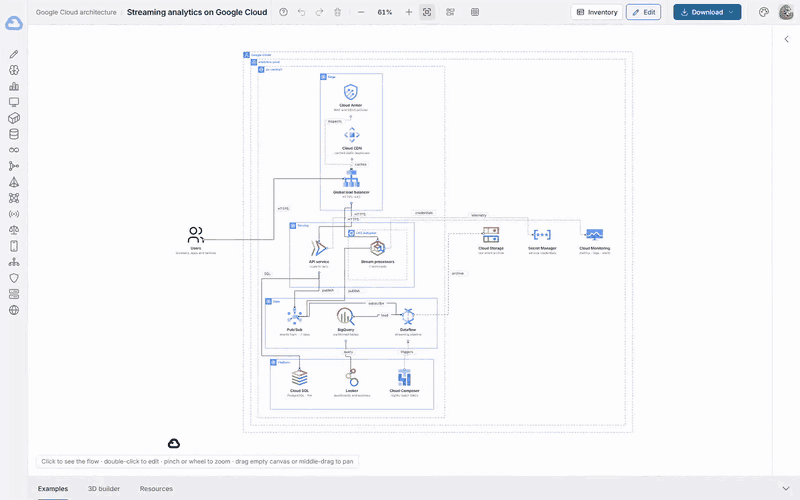](docs/media/infragram-tour.mp4) |

*Click a card and its wires animate in the traffic's direction; click a frame or a caption for theirs; right-click for what the internet reaches or what a service depends on. Four examples from `plugin/examples`.*
[Watch the whole 85-second tour (MP4)](docs/media/infragram-tour.mp4) · [Editor demo](#editor-demo) · [Animated mascot](docs/images/infragram-engineer.gif) · [Mascot artwork](docs/images/infragram-mascot.png)

[How your agent uses it](#how-your-agent-uses-it) · [Quick start](#quick-start) · [Gallery](#gallery) · [Commands](#commands) · [Documentation](docs/README.md)

## How your agent uses it

Install the plugin once (Claude Code shown; Codex and Pi are in
[installation](docs/install.md), and any MCP client can run `infragram mcp`):

```bash
claude plugin marketplace add <repository>
claude plugin install infragram-architect@infragram-architect
```

Then ask in plain words:

> Draw our shop on AWS: shoppers through CloudFront and WAF to a load balancer,
> the API on Fargate in two availability zones, Aurora PostgreSQL, Redis for
> sessions, S3 for assets.

What the agent does with the Infragram skill:

1. **Finds the parts.** `infragram find "fargate"` returns the class to import,
   for every service, with the vendor's own icon behind it.
2. **Writes the diagram as code.** A short Python file: frames are `with`
   blocks (cloud, region, VPC, availability zone, subnet), wires are `>>`.
3. **Draws it.** `infragram compose --verify` lays it out, routes the wires
   around the cards and writes the HTML editor, the SVG and the PNG.
4. **Checks its own work.** The plugin's hook reads every diagram file the
   agent writes and catches a misspelled name or an icon class in the wrong
   module; `--verify` then reads the picture: no wire through a card or along a
   frame's border, no caption off its wire, frames nested the way the cloud
   nests them. What fails goes back to the agent to fix before you see it.
5. **Hands it over.** You open the HTML, drag what you'd like elsewhere, and
   download a PNG, SVG, draw.io file or Terraform.

The prompt above, drawn exactly that way (2,079 picture checks passed):

[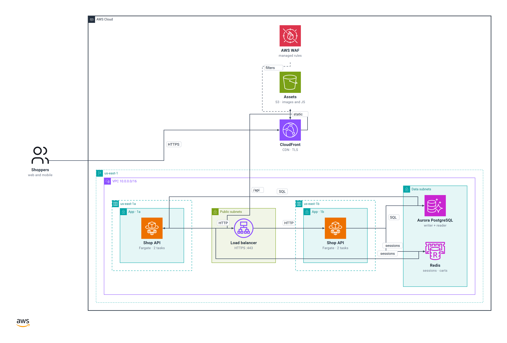](docs/images/agent-example.png)

The same commands are an MCP server (`infragram mcp`): any agent can compose,
check, find and import, and gets data back with a PNG preview of what it made.
A bundled `diagram-reviewer` agent gives a second opinion on a finished picture.

## What it does

- **Build or import:** Python diagrams, Terraform, live AWS/Azure/GCP/Kubernetes, and common diagram formats.
- **Edit offline:** drag components, connect wires, nest frames, change styles and switch themes in the exported HTML.
- **Use vendor libraries:** 19 libraries, 3,620 icons and containment rules for cloud and datacenter architecture.
- **Know what it costs:** every AWS, Azure and Google Cloud component priced from on-demand list prices, added up in the page by frame and item, line by line.
- **Review infrastructure:** filtered views, change diffs, cost estimates and policy checks.
- **Work with agents:** Claude Code, Codex and Pi plugins, plus an MCP server.

## Quick start

From a checkout, with Python 3.11+ and [uv](https://docs.astral.sh/uv/):

```bash
uv tool install "./plugin[png]" --with-executables-from playwright
playwright install chromium
infragram new aws_three_tier shop.py
infragram compose shop.py
```

Open `dist/shop.html` to edit the diagram. The same command writes SVG and PNG.
Use `infragram find "load balancer"` to find a component or `infragram templates`
to list starter diagrams. See [installation](docs/install.md),
[Python authoring](docs/usage.md#compose-as-code) or [troubleshooting](docs/troubleshooting.md).

## Editor demo

[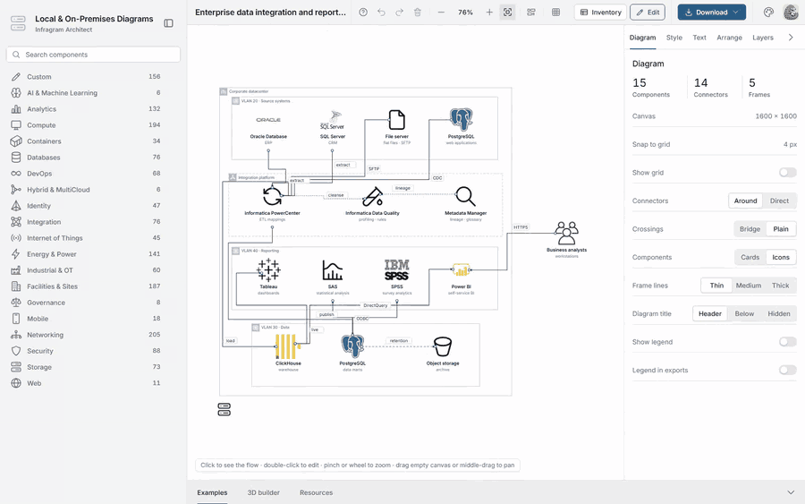](docs/media/infragram-editor.mp4)

*45 seconds in the HTML editor: search, follow the flow stage by stage, edit, drag, tidy, switch themes and view export options.*
[Watch the MP4](docs/media/infragram-editor.mp4)

## Gallery

Start from 34 reference architectures, a Databricks lakehouse or six 3D examples.
The pictures below are app exports; paired images show cards and bare icons.

```bash
infragram new --template azure-hub-spoke-landing-zone
infragram export:project azure-hub-spoke-landing-zone.infragram.json
```

Open `dist/azure-hub-spoke-landing-zone.html` to edit it offline.

[AWS](#aws) · [Azure](#azure) · [Drawn in 3D](#drawn-in-3d) · [Every other cloud](#every-other-cloud) · [Hybrid and networks](#hybrid-and-networks) · [Datacenter and platforms](#datacenter-and-platforms) · [Data and security](#data-and-security)

### AWS

**Three-tier web application on AWS** · `aws-three-tier-web`  
A load balancer in public subnets, web servers and a Multi-AZ database in private ones.

| Cards | Icons |
|---|---|
| [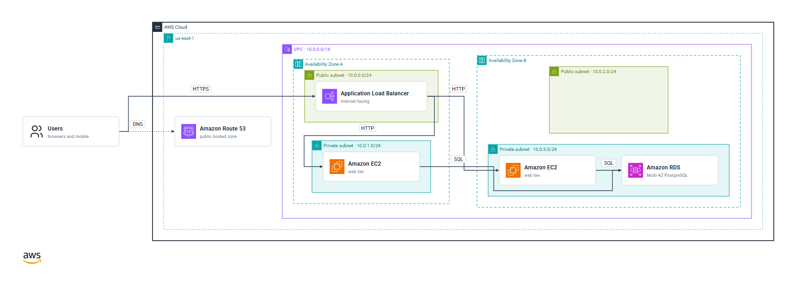](docs/images/gallery/aws-three-tier-web.png) | [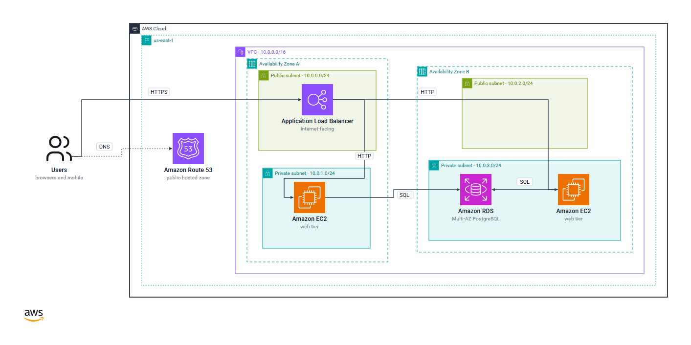](docs/images/gallery/aws-three-tier-web-icons.png) |

**AWS Site-to-Site VPN to an Amazon VPC** · `aws-site-to-site-vpn`  
IPsec over Direct Connect from a corporate network into an Amazon VPC.

| Cards | Icons |
|---|---|
| [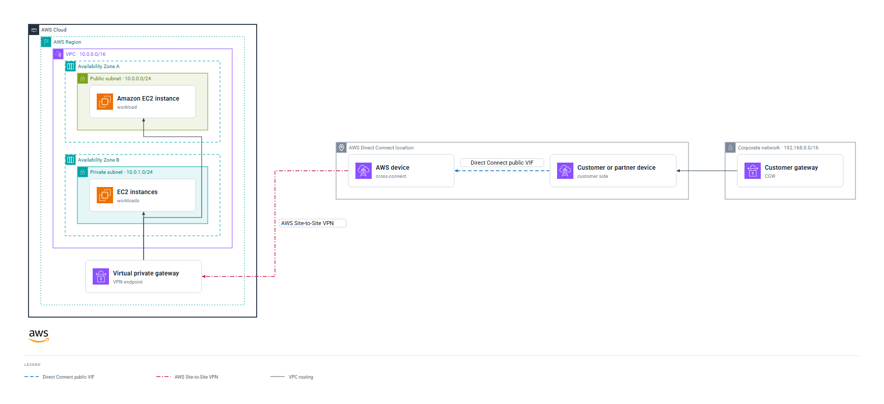](docs/images/gallery/aws-site-to-site-vpn.png) | [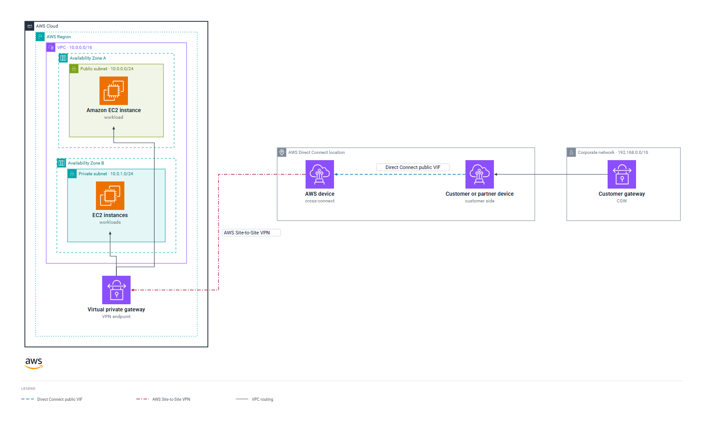](docs/images/gallery/aws-site-to-site-vpn-icons.png) |

**RStudio and Shiny analytics platform** · `rstudio-shiny-analytics-platform`  
Shiny on Fargate and RStudio on EC2 across two Availability Zones, with the shared AWS services above them.

| Cards | Icons |
|---|---|
| [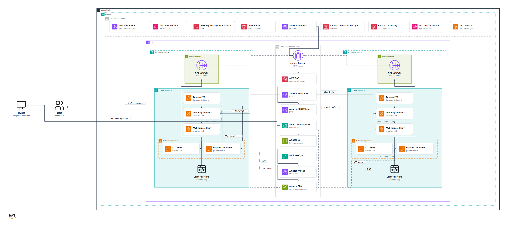](docs/images/gallery/rstudio-shiny-analytics-platform.png) | [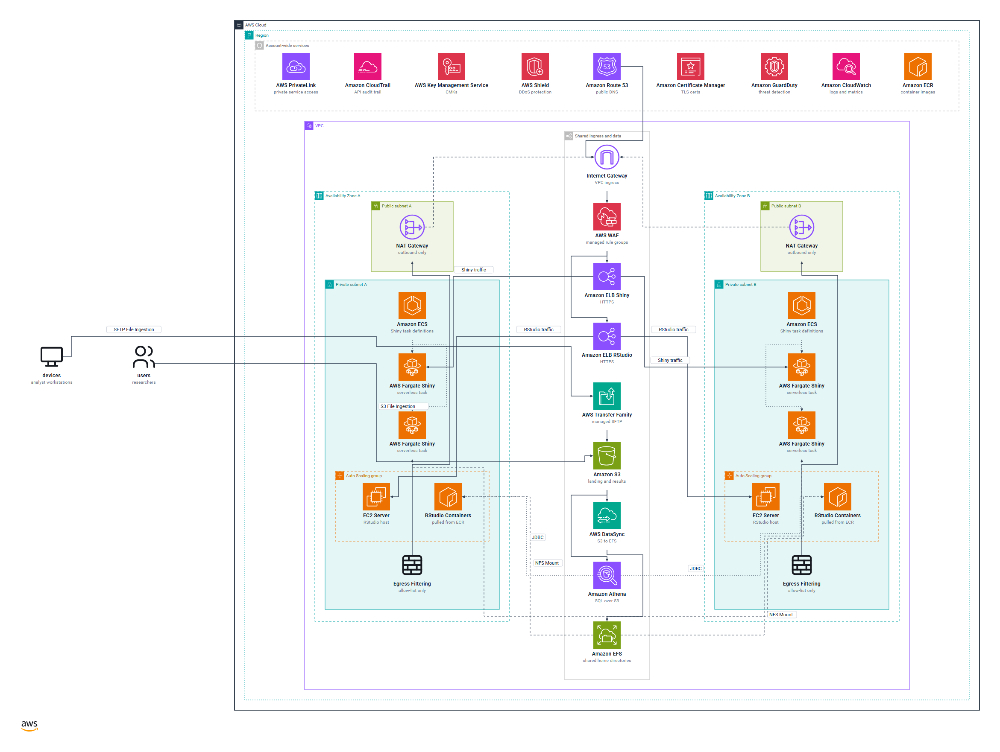](docs/images/gallery/rstudio-shiny-analytics-platform-icons.png) |

**Private Direct Connect staging platform** · `private-dx-staging-platform`  
DataStage lands on-premises SQL Server data in an AWS staging VPC over private Direct Connect.

| Cards | Icons |
|---|---|
| [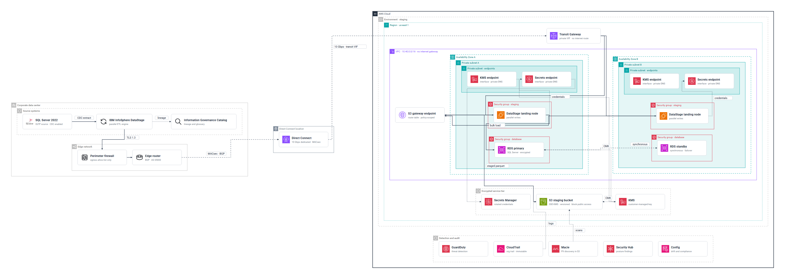](docs/images/gallery/private-dx-staging-platform.png) | [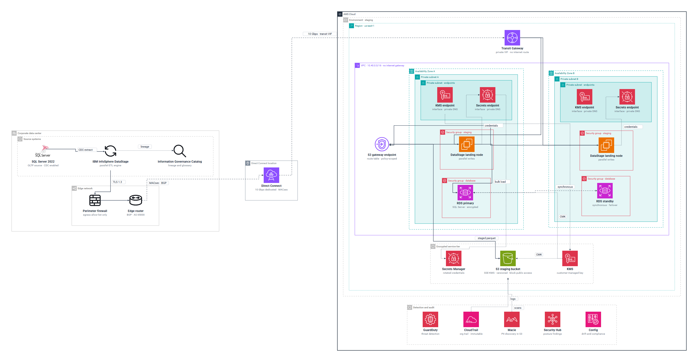](docs/images/gallery/private-dx-staging-platform-icons.png) |

### Azure

**Azure hub-and-spoke landing zone** · `azure-hub-spoke-landing-zone`  
A connectivity hub, production and development landing zones and a management subscription, from one file.

| Cards | Icons |
|---|---|
| [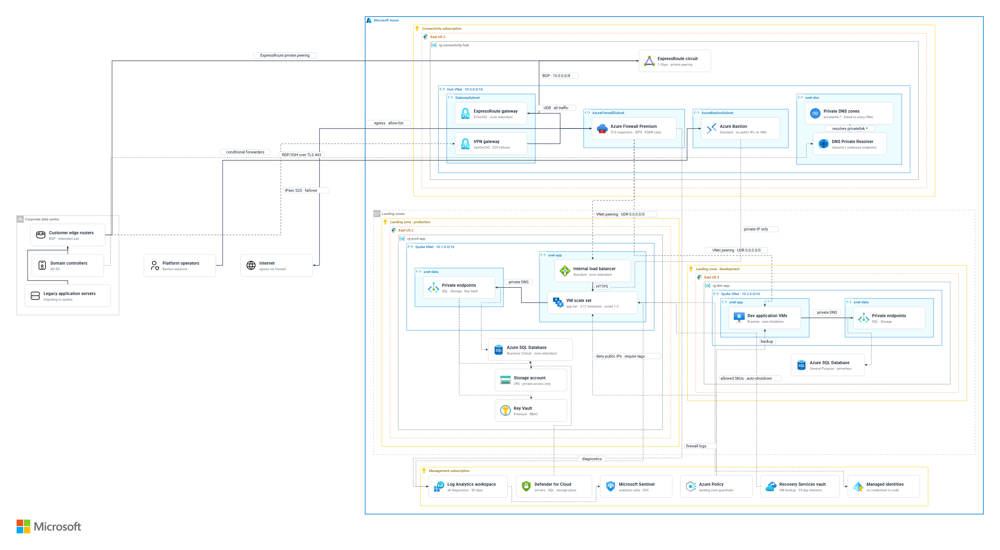](docs/images/gallery/azure-hub-spoke-landing-zone.png) | [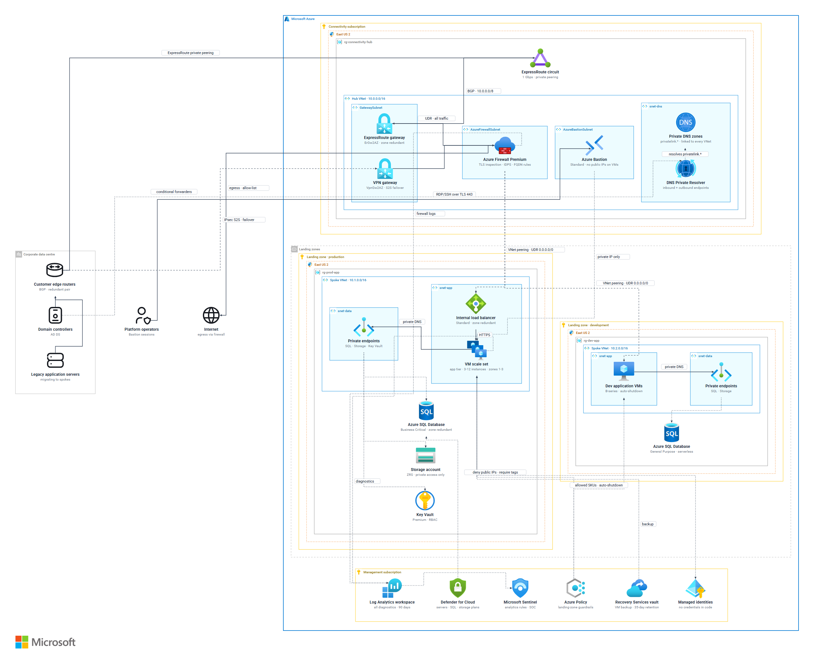](docs/images/gallery/azure-hub-spoke-landing-zone-icons.png) |

**AKS production baseline** · `azure-aks-baseline`  
A private AKS cluster in its own spoke, Application Gateway as the only way in, egress through Azure Firewall.

| Cards | Icons |
|---|---|
| [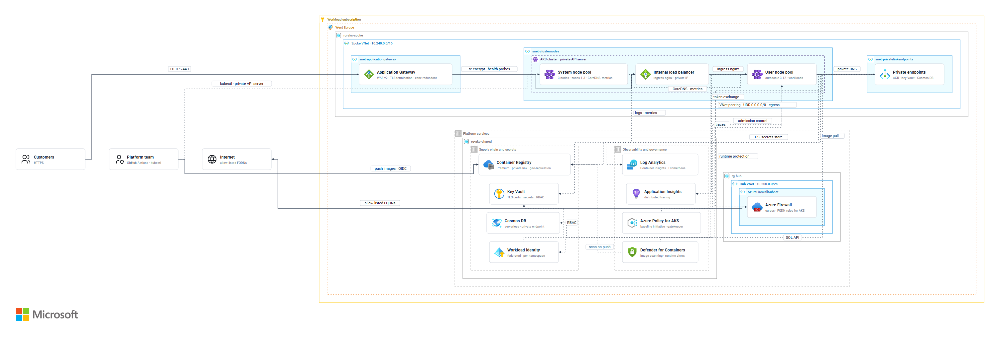](docs/images/gallery/azure-aks-baseline.png) | [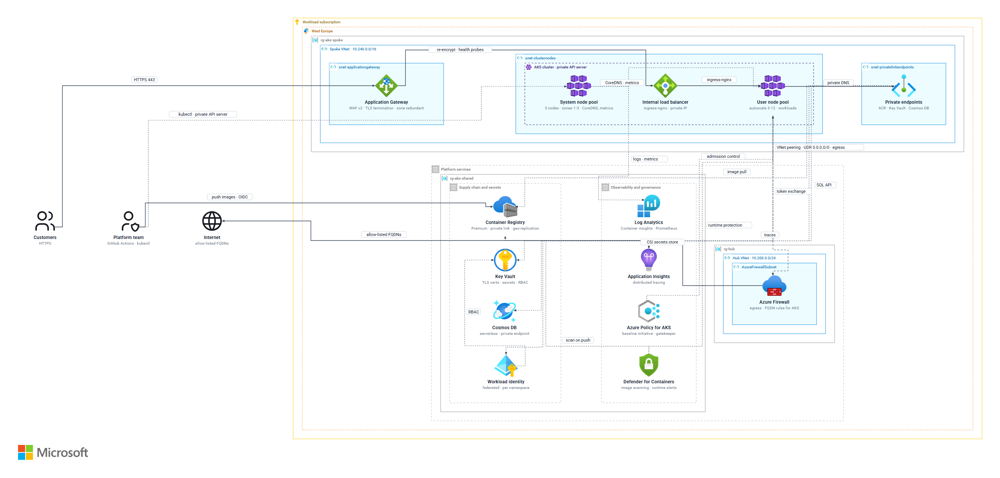](docs/images/gallery/azure-aks-baseline-icons.png) |

**Zone-redundant web app behind Front Door** · `azure-web-app-front-door`  
Front Door Premium as the only public surface, Private Link to App Service, a warm standby region.

| Cards | Icons |
|---|---|
| [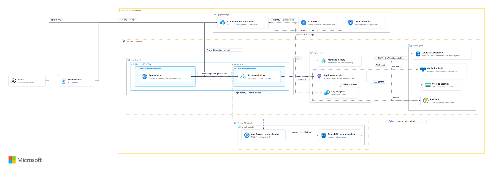](docs/images/gallery/azure-web-app-front-door.png) | [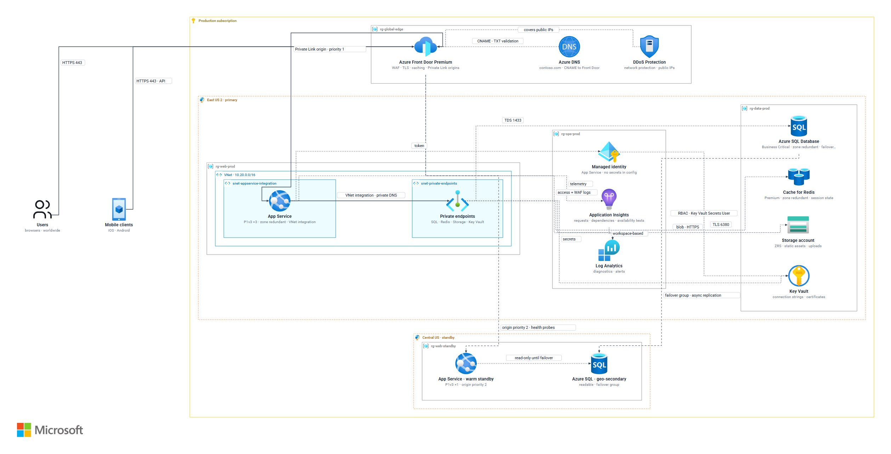](docs/images/gallery/azure-web-app-front-door-icons.png) |

**Azure API reference** · `azure-api`  
The smallest Azure picture: Application Gateway, App Service, Storage.

| Cards | Icons |
|---|---|
| [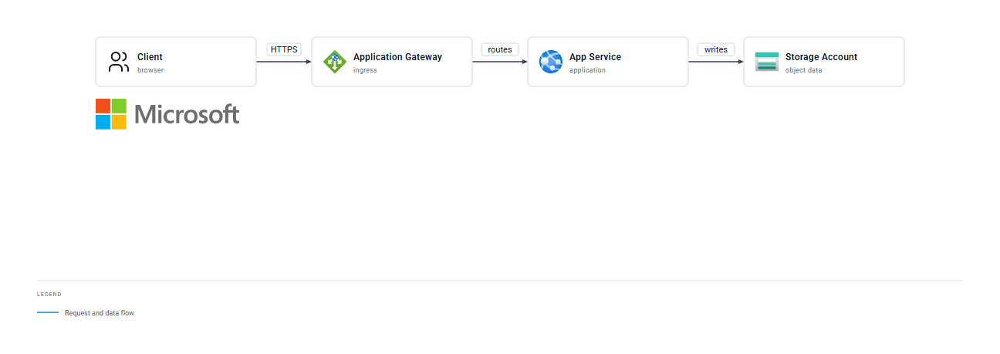](docs/images/gallery/azure-api-reference.png) | [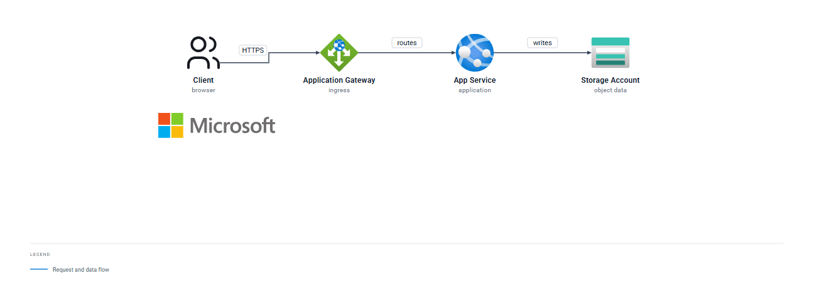](docs/images/gallery/azure-api-reference-icons.png) |

### Drawn in 3D

Over 800 rendered datacentre, network and energy items: racks, switches, substations,
wind farms, heat pumps, phones. Start your own from any of these:

```bash
infragram new onprem_datacenter_3d my_datacentre.py
infragram compose my_datacentre.py          # dist/my-datacentre.html, .svg, .png
```

**On-premises datacentre, 3D** · `onprem_datacenter_3d`  
A perimeter, a hall with compute and storage rows, the power and cooling behind them, and a campus of users.

[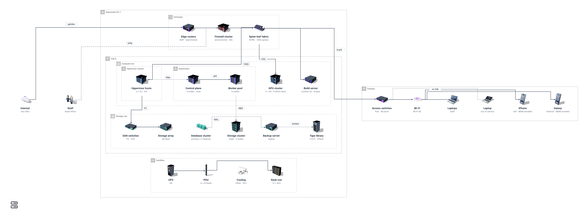](docs/images/gallery/onprem-datacenter-3d.png)

**The power grid, from the plant to the meter** · `onprem_power_grid_3d`  
Generation, 400 kV transmission, the substation, distribution and the customers at the end of the line.

[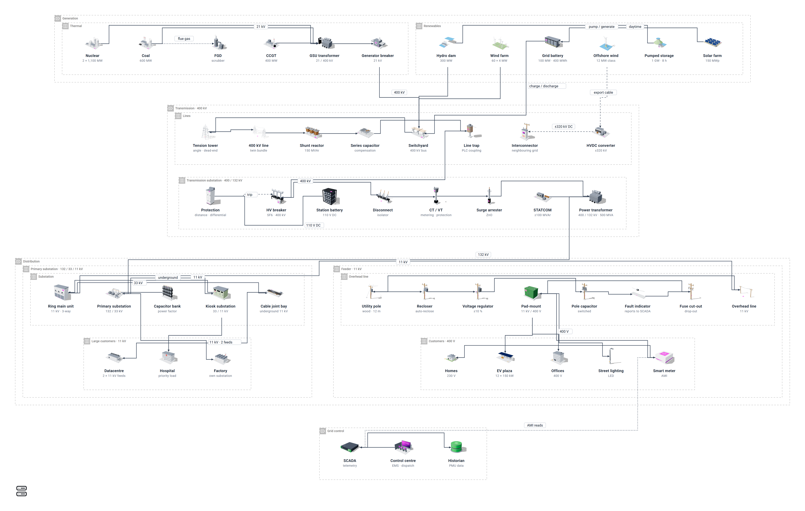](docs/images/gallery/onprem-power-grid-3d.png)

**Campus microgrid** · `onprem_microgrid_3d`  
Grid, solar, wind, CHP, battery and hydrogen behind one campus switchboard, and the controller that islands it.

[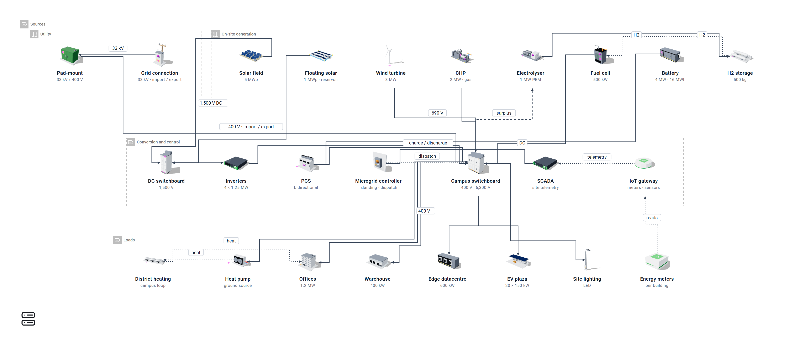](docs/images/gallery/onprem-microgrid-3d.png)

**How power reaches a server** · `onprem_power_chain_3d`  
From a gas plant through the grid and the building's power chain to a server's power supplies.

[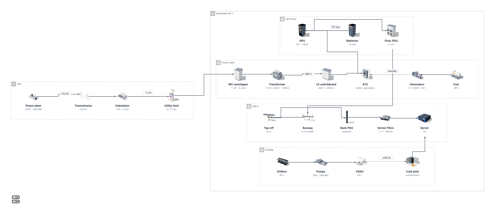](docs/images/gallery/onprem-power-chain-3d.png)

**A home's energy, from the pole to the plug** · `onprem_home_energy_3d`  
The grid's last mile, the panel wall, rooftop solar and a battery, and the loads they serve.

[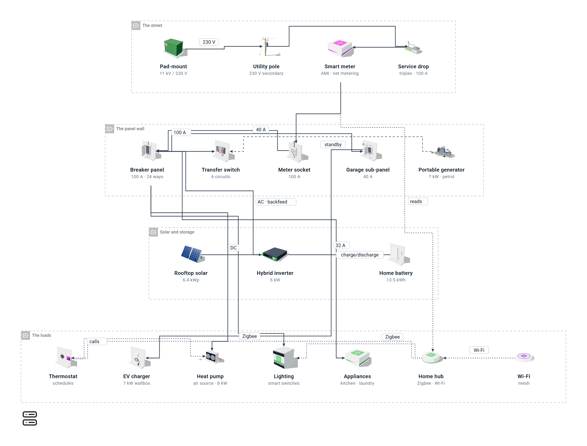](docs/images/gallery/onprem-home-energy-3d.png)

**Rendered by spec** · `onprem_custom_3d`  
Items no library ships, described in a line of Python and rendered in 3D when the diagram is composed.

[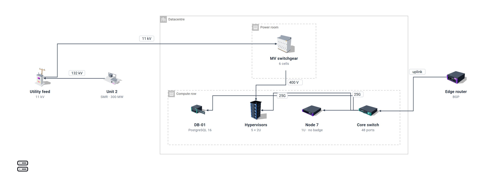](docs/images/gallery/onprem-custom-3d.png)

### Every other cloud

**Three-tier web application on Google Cloud** · `gcp-three-tier-web`  
Cloud Armor and Cloud CDN in front of GKE and Cloud Run, Cloud SQL and Memorystore behind.

| Cards | Icons |
|---|---|
| [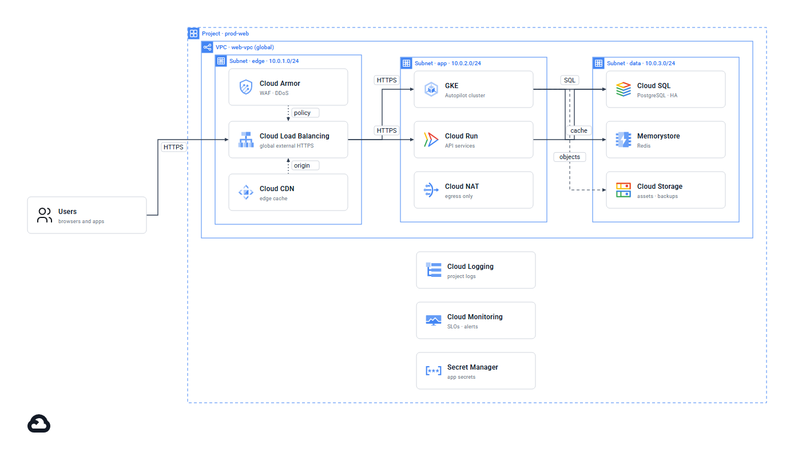](docs/images/gallery/gcp-three-tier-web.png) | [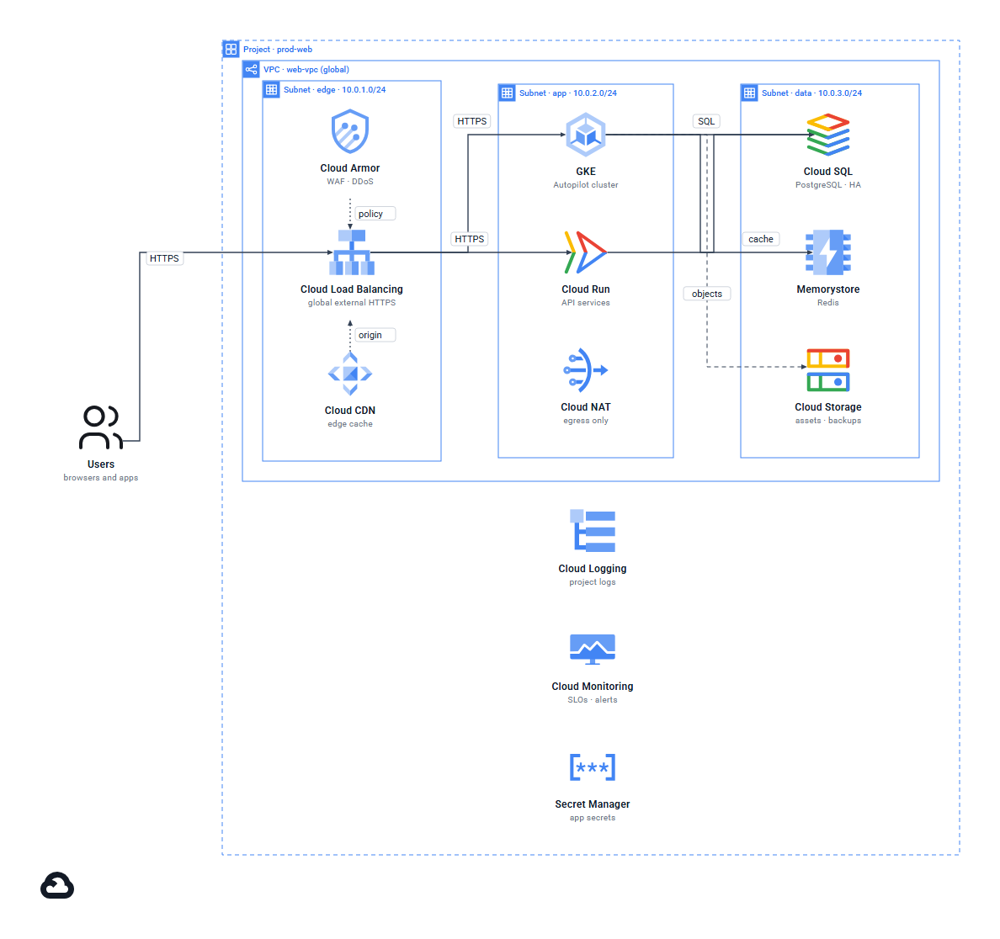](docs/images/gallery/gcp-three-tier-web-icons.png) |

**Oracle Cloud landing zone with a three-tier workload** · `oracle-oci-landing-zone`  
A tenancy, a production compartment, public, app and data subnets, FastConnect home.

| Cards | Icons |
|---|---|
| [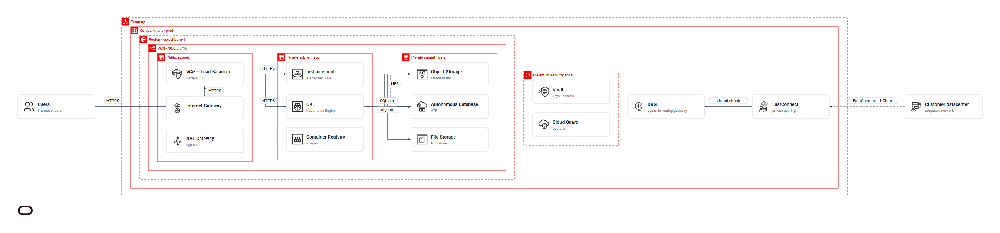](docs/images/gallery/oracle-oci-landing-zone.png) | [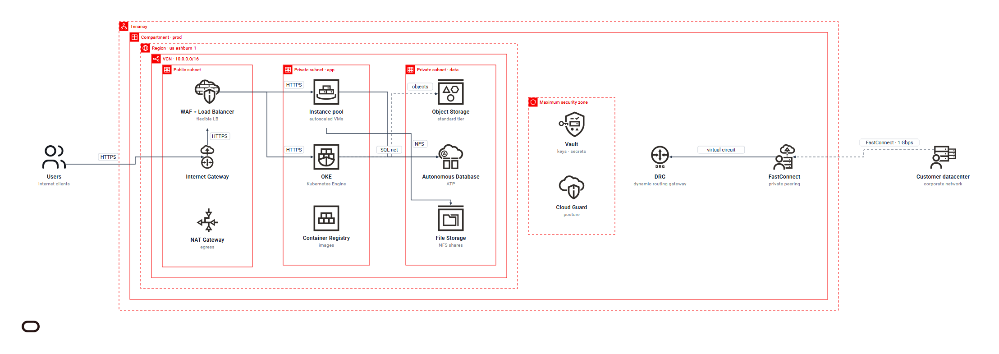](docs/images/gallery/oracle-oci-landing-zone-icons.png) |

**Application on IBM Cloud VPC** · `ibm-vpc-application`  
A regional VPC with web, app and data subnets, drawn with IBM's own Carbon icons.

| Cards | Icons |
|---|---|
| [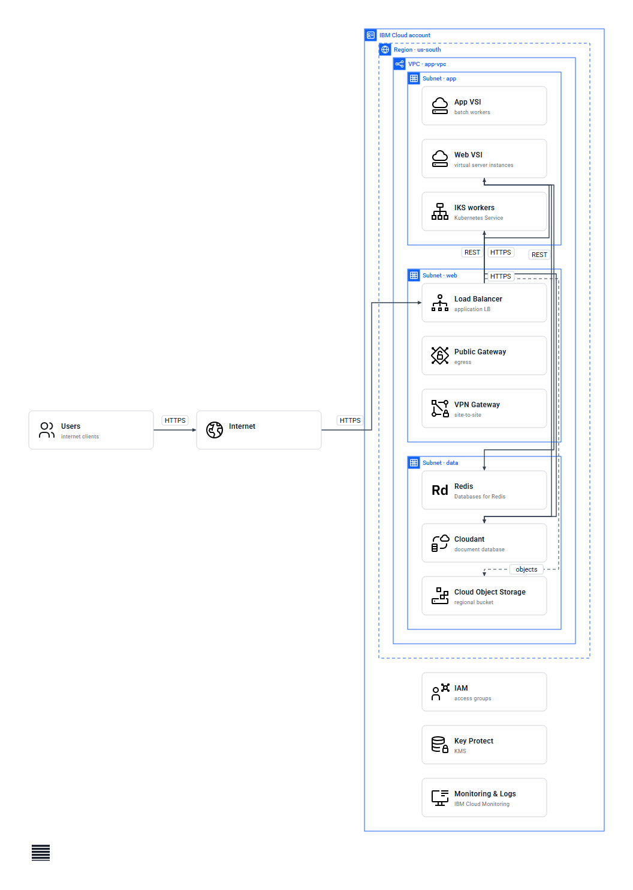](docs/images/gallery/ibm-vpc-application.png) | [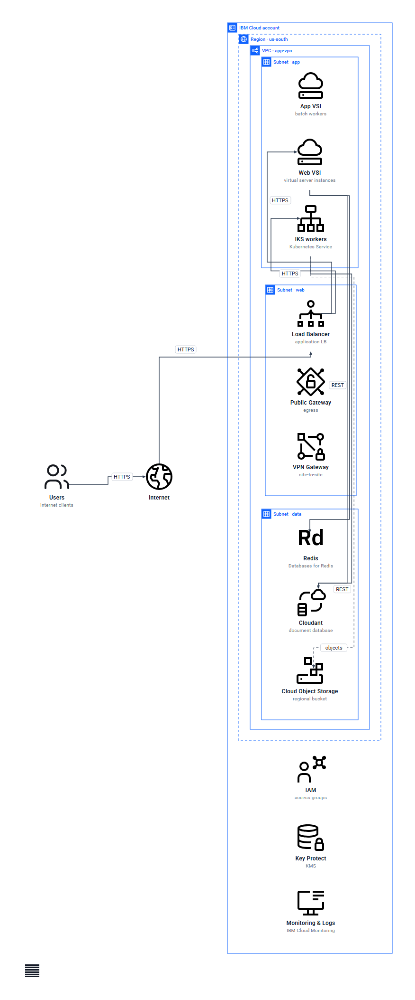](docs/images/gallery/ibm-vpc-application-icons.png) |

**Web application on Alibaba Cloud** · `alibaba-web-application`  
DNS, CDN and Anti-DDoS in front of a load-balanced web tier across two zones.

| Cards | Icons |
|---|---|
| [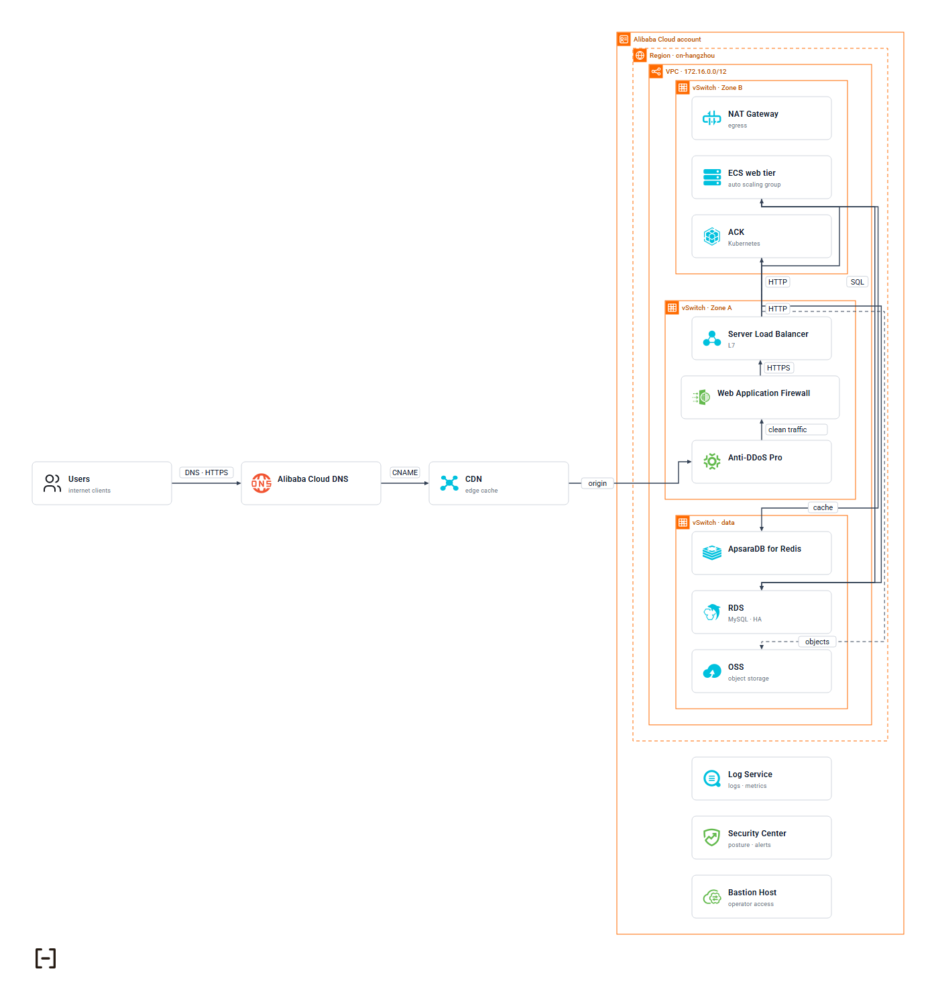](docs/images/gallery/alibaba-web-application.png) | [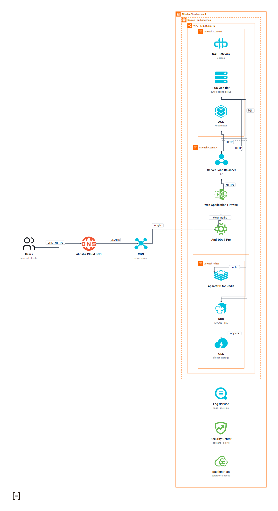](docs/images/gallery/alibaba-web-application-icons.png) |

**Cloudflare edge platform with an on-premises origin** · `cloudflare-edge-platform`  
DNS, WAF and CDN at the edge, Workers and Pages, and a tunnel home to the origin.

| Cards | Icons |
|---|---|
| [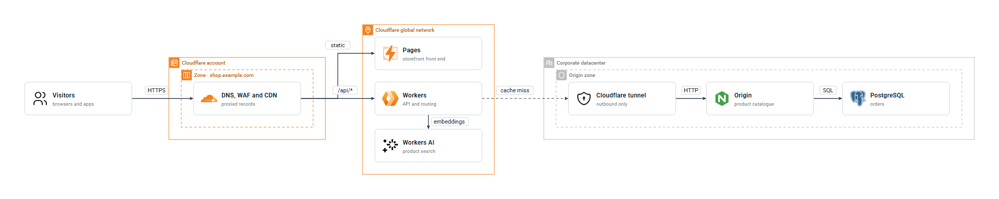](docs/images/gallery/cloudflare-edge-platform.png) | [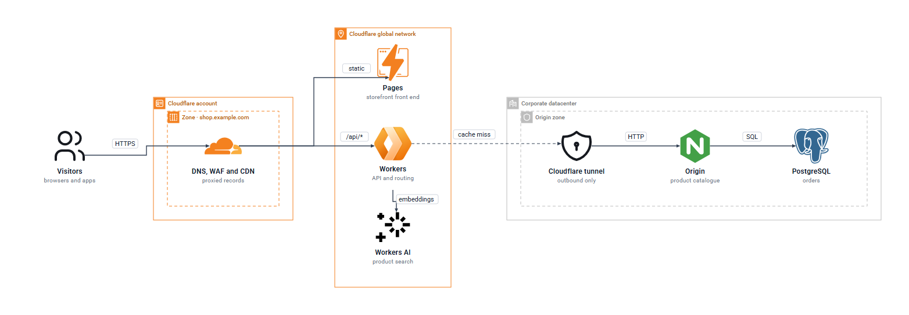](docs/images/gallery/cloudflare-edge-platform-icons.png) |

**DigitalOcean Kubernetes application cluster** · `digitalocean-kubernetes-cluster`  
A load balancer into DOKS, three worker nodes, Managed PostgreSQL and Spaces.

| Cards | Icons |
|---|---|
| [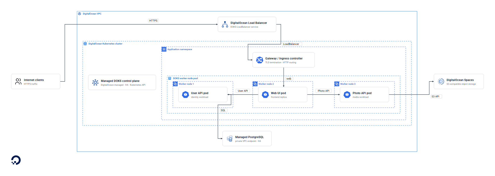](docs/images/gallery/digitalocean-kubernetes-cluster.png) | [](docs/images/gallery/digitalocean-kubernetes-cluster-icons.png) |

**DigitalOcean application delivery** · `digitalocean-application-delivery`  
Load Balancer, App Platform, a managed database and Spaces backups.

| Cards | Icons |
|---|---|
| [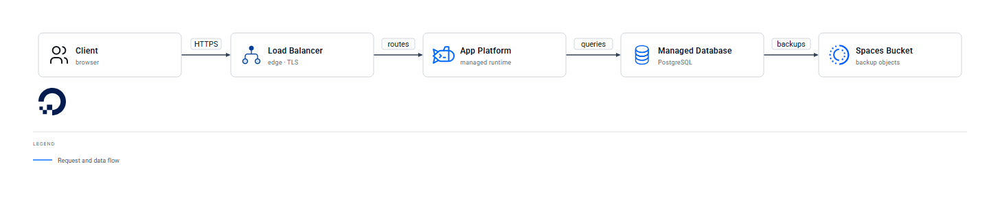](docs/images/gallery/digitalocean-application-delivery.png) | [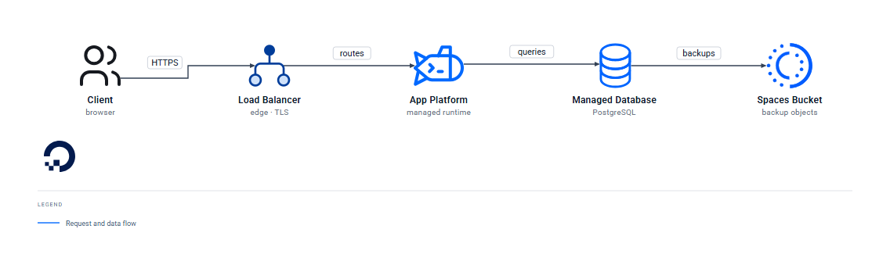](docs/images/gallery/digitalocean-application-delivery-icons.png) |

**DigitalOcean infrastructure template** · `digitalocean-base`  
A starting canvas with the DigitalOcean library and a DOKS foundation.

| Cards | Icons |
|---|---|
| [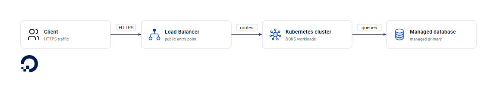](docs/images/gallery/digitalocean-base.png) | [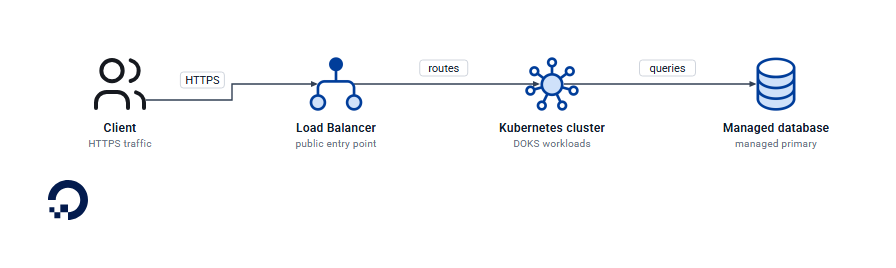](docs/images/gallery/digitalocean-base-icons.png) |

**Hetzner Cloud application delivery** · `hetzner-application-delivery`  
A Hetzner load balancer, a cloud server, PostgreSQL and object storage.

| Cards | Icons |
|---|---|
| [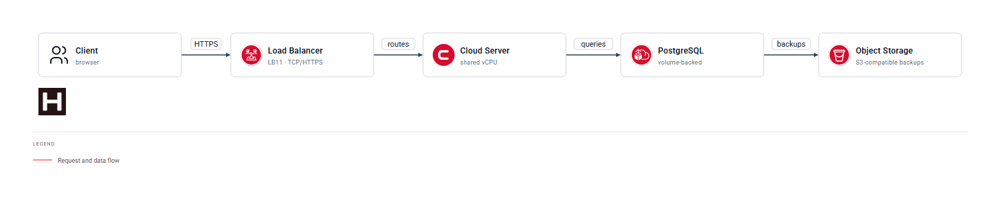](docs/images/gallery/hetzner-application-delivery.png) | [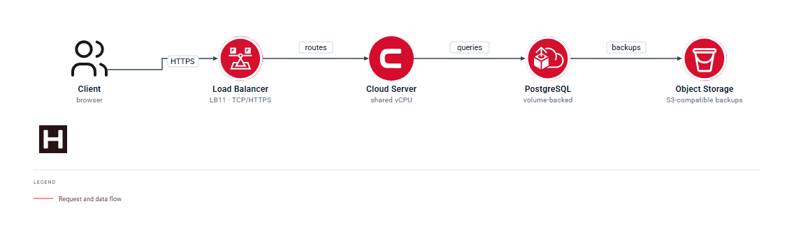](docs/images/gallery/hetzner-application-delivery-icons.png) |

**Multicloud application platform** · `multicloud-base`  
One canvas, every library: a service from each cloud on one wire.

| Cards | Icons |
|---|---|
| [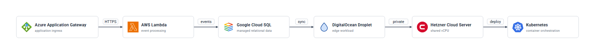](docs/images/gallery/multicloud-base.png) | [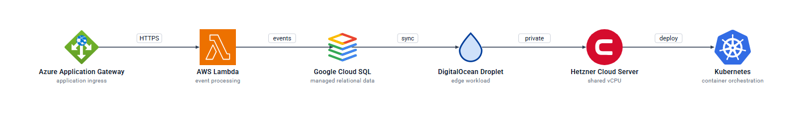](docs/images/gallery/multicloud-base-icons.png) |

### Hybrid and networks

**Multi-homed datacenter with BGP to two ISPs and AWS** · `hybrid-bgp-edge`  
Two edge routers multi-homed to two ISPs over eBGP, OSPF inside, a branch over IPsec, AWS over Direct Connect.

| Cards | Icons |
|---|---|
| [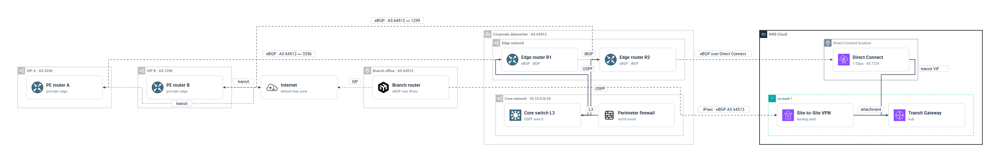](docs/images/gallery/hybrid-bgp-edge.png) | [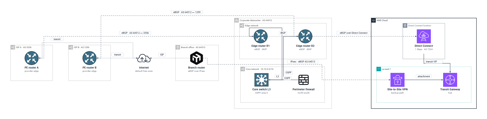](docs/images/gallery/hybrid-bgp-edge-icons.png) |

**Mainframe modernisation with an event-driven bridge to AWS** · `mainframe-modernization`  
IBM Z keeps the system of record; change data capture, MQ and file transfer bridge it to AWS.

| Cards | Icons |
|---|---|
| [](docs/images/gallery/mainframe-modernization.png) | [](docs/images/gallery/mainframe-modernization-icons.png) |

**Campus LAN with two buildings and a branch over the WAN** · `campus-lan-wan`  
An MDF, two buildings' IDF closets, network services and a branch office over the WAN.

| Cards | Icons |
|---|---|
| [](docs/images/gallery/campus-lan-wan.png) | [](docs/images/gallery/campus-lan-wan-icons.png) |

**Zero-trust access with a central identity provider** · `zero-trust-identity`  
Every user and device through an identity provider with hardware MFA before anything inside.

| Cards | Icons |
|---|---|
| [](docs/images/gallery/zero-trust-identity.png) | [](docs/images/gallery/zero-trust-identity-icons.png) |

**Virtual desktop infrastructure with cloud burst** · `vdi-remote-work`  
Thin clients and laptops into Citrix through a zero-trust gateway, bursting to Azure Virtual Desktop.

| Cards | Icons |
|---|---|
| [](docs/images/gallery/vdi-remote-work.png) | [](docs/images/gallery/vdi-remote-work-icons.png) |

**Plant OT network with an industrial DMZ and cloud telemetry** · `ot-iot-edge`  
A plant's OT zone, an industrial DMZ and edge compute, streaming telemetry to Azure IoT.

| Cards | Icons |
|---|---|
| [](docs/images/gallery/ot-iot-edge.png) | [](docs/images/gallery/ot-iot-edge-icons.png) |

### Datacenter and platforms

**On-premises datacenter with a branch office** · `onprem-datacenter`  
A branch office into a corporate datacenter: perimeter, VLANs, a virtualisation cluster and monitoring.

| Cards | Icons |
|---|---|
| [](docs/images/gallery/onprem-datacenter.png) | [](docs/images/gallery/onprem-datacenter-icons.png) |

**On-premises Kubernetes platform** · `onprem-kubernetes-platform`  
Bare-metal Kubernetes: MetalLB and ingress, the shop namespace, Rook-Ceph, GitOps and the platform tools.

| Cards | Icons |
|---|---|
| [](docs/images/gallery/onprem-kubernetes-platform.png) | [](docs/images/gallery/onprem-kubernetes-platform-icons.png) |

**OpenStack private cloud with a tenant project** · `openstack-private-cloud`  
Keystone, Horizon and the CLI in front of a tenant project running Nova, Octavia, Trove and Manila.

| Cards | Icons |
|---|---|
| [](docs/images/gallery/openstack-private-cloud.png) | [](docs/images/gallery/openstack-private-cloud-icons.png) |

**VMware vSphere estate in a corporate datacenter** · `vmware-vsphere-estate`  
vCenter, two ESXi hosts with an AlwaysOn pair, a distributed switch and the storage behind.

| Cards | Icons |
|---|---|
| [](docs/images/gallery/vmware-vsphere-estate.png) | [](docs/images/gallery/vmware-vsphere-estate-icons.png) |

**Proxmox VE homelab cluster** · `proxmox-homelab-cluster`  
pfSense in front of a three-node Proxmox cluster, a reverse proxy and backups to TrueNAS.

| Cards | Icons |
|---|---|
| [](docs/images/gallery/proxmox-homelab-cluster.png) | [](docs/images/gallery/proxmox-homelab-cluster-icons.png) |

**SAN storage fabric with dual fabrics and replication** · `onprem-storage-fabric`  
Hosts on two Fibre Channel fabrics, a primary and secondary array, NAS and tape.

| Cards | Icons |
|---|---|
| [](docs/images/gallery/onprem-storage-fabric.png) | [](docs/images/gallery/onprem-storage-fabric-icons.png) |

**Disaster recovery and backup across two sites and a cloud tier** · `onprem-dr-backup`  
Two sites and a cloud tier: replication, streaming standby, Veeam, tape and Glacier.

| Cards | Icons |
|---|---|
| [](docs/images/gallery/onprem-dr-backup.png) | [](docs/images/gallery/onprem-dr-backup-icons.png) |

### Data and security

**Databricks lakehouse on AWS** · `databricks_lakehouse_aws`  
Auto Loader and a Lakeflow pipeline land S3 files in Delta tables, a SQL warehouse serves
AI/BI dashboards, and Unity Catalog governs it all and shares the gold tables.

| Cards | Icons |
|---|---|
| [](docs/images/gallery/databricks-lakehouse-aws.png) | [](docs/images/gallery/databricks-lakehouse-aws-icons.png) |

**Hadoop data platform with analytics** · `onprem-data-platform`  
Kafka and databases into NiFi and Flink, a Hadoop cluster with Spark, Hive and Trino, analytics on top.

| Cards | Icons |
|---|---|
| [](docs/images/gallery/onprem-data-platform.png) | [](docs/images/gallery/onprem-data-platform-icons.png) |

**Enterprise data integration and reporting** · `enterprise-data-integration`  
Source systems through an integration platform into a warehouse, data marts and four reporting tools.

| Cards | Icons |
|---|---|
| [](docs/images/gallery/enterprise-data-integration.png) | [](docs/images/gallery/enterprise-data-integration-icons.png) |

**Security operations centre with a SIEM pipeline** · `soc-siem`  
Every log source through collectors into a SIEM cluster, with threat intelligence, paging and tickets.

| Cards | Icons |
|---|---|
| [](docs/images/gallery/soc-siem.png) | [](docs/images/gallery/soc-siem-icons.png) |

## Commands

Run `infragram --help` or `infragram <command> --help` for options.

[//]: # (commands:start)

| Command | What it does |
|---|---|
| `new` | start a diagram file from a shipped example (or a document from a template with --template): its own title and slug, ready to compose |
| `templates` | list the shipped template documents: name, title, libraries, elements and connections; new --template starts from one |
| `compose` | run a Python diagram file and export it to HTML, SVG and PNG |
| `export:project` | render a .infragram.json document to HTML, SVG and PNG |
| `export:set` | export a folder of diagram files, one folder per diagram, checked, with the set's README |
| `find` | which class to import for a component: s3, aks, load balancer, vpc; best match first, then the patterns; --library lists a whole library, --libraries the libraries |
| `recipes` | the 3D items drawn by spec: every recipe with its knobs, the families, colours and glyphs; one in detail, or drawn to an SVG with --svg |
| `diff` | what changed between two versions of a diagram, written out and drawn |
| `check:policy` | what a reviewer would stop in a diagram (a database in a public subnet, the internet reaching a database), and Checkov or Trivy on a Terraform folder when installed |
| `views` | list what --view can draw from a diagram: the views it declares, and every frame by level |
| `costs` | what a diagram costs a month, approximately, added up by frame: AWS, Azure and Google Cloud priced from the shipped tables, --prices live, or an Infracost breakdown; --csv writes it out |
| `layout:save` | keep what was moved in the editor beside a diagram file, so compose draws it where it was left |
| `schema` | the JSON Schema of an .infragram.json document, for an editor's completion |
| `docs` | list the reference documents the skill ships (compose, frames, providers/aws...), print one, or --path to say where it is |
| `check` | check documents and exported pages: structure, real components, the picture itself, nothing remote |
| `check:terraform` | check that a diagram's Terraform works without deploying it: fmt, init and validate offline, then a plan against mocked providers |
| `verify:render` | render a diagram several times, prove the passes identical, and check the picture in both looks |
| `import:terraform` | draw what a Terraform configuration, plan or state declares: an editable diagram file, a report, and the diagram exported |
| `import:diagram` | draw a draw.io, Mermaid, PlantUML, Excalidraw or Visio diagram (or a Markdown page's blocks) as an editable diagram file, a report, and the diagram exported |
| `import:drawio` | import:diagram for a draw.io file: .drawio, .drawio.png, .drawio.svg, every page |
| `import:mermaid` | import:diagram for Mermaid: a .mmd file, or a Markdown page's mermaid blocks |
| `discover:aws` | draw a live AWS estate, read-only through the aws CLI |
| `discover:azure` | draw a live Azure estate, read-only through the az CLI |
| `discover:gcp` | draw a live Google Cloud estate, read-only through the gcloud CLI |
| `discover:kubernetes` | draw a live Kubernetes cluster, read-only through kubectl |
| `mcp` | serve these commands to an MCP client over stdio (the plugin's MCP server) |
| `hook:check` | the plugin's check hook: check a diagram an agent just wrote (event JSON on stdin) |
| `plugin:install` | register the plugin this copy carries with Claude Code, Codex or Pi |
| `plugin:path` | print the plugin folder this copy carries |

The maintainer commands need a checkout of the repository; `infragram --help` lists them, and [Development](#development) says which to run when.

[//]: # (commands:end)

## Documentation

[All guides](docs/README.md) · [Usage and exports](docs/usage.md) ·
[Installation](docs/install.md) · [Troubleshooting](docs/troubleshooting.md) ·
[Component inventory](docs/inventory/README.md)

## Development

See [development setup and verification commands](docs/maintainers/development.md)
and [contributing](CONTRIBUTING.md) for the repository layout and review process.

## License

Project code is [MIT-licensed](LICENSE). Provider artwork has its own terms;
see [artwork provenance](docs/licenses.md) and [third-party licenses](plugin/THIRD_PARTY_LICENSES.md).
